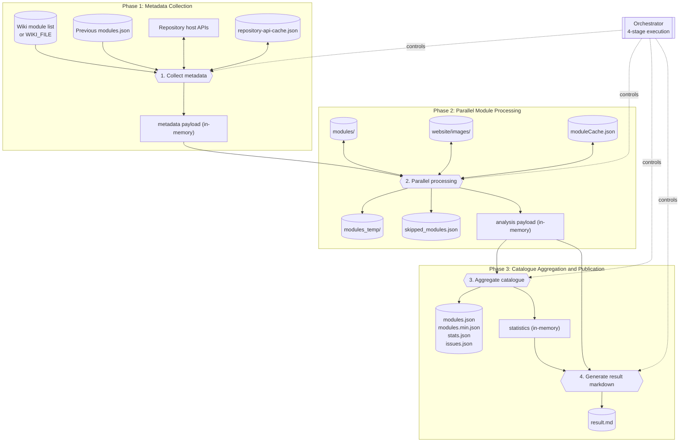
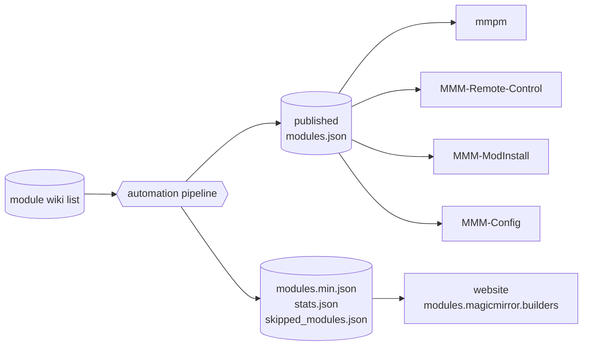
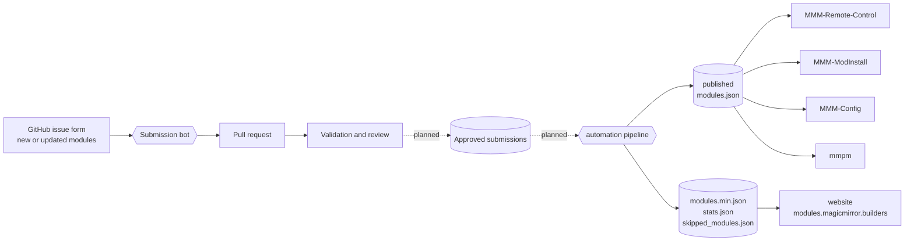

# Pipeline Architecture

Visibility into the automation that builds and publishes the third-party module catalogue helps contributors reason about changes and spot failure points early. This document summarizes the current canonical pipeline and the parts of the broader architecture that are still future-facing.

## Pipeline

The supported production pipeline is orchestrated via `node scripts/orchestrator/index.ts` (also exposed as `node --run all`). The orchestrator drives four stages across three operational phases: metadata collection, parallel module processing, and publication. The publication phase contains stages 3 and 4.

### Stage Overview

| Order | Stage ID                   | Key Outputs                                                                                                                                      |
| ----- | -------------------------- | ------------------------------------------------------------------------------------------------------------------------------------------------ |
| 1     | `collect-metadata`         | in-memory metadata payload, `website/data/cache/repository-api-cache.json`                                                                       |
| 2     | `parallel-processing`      | in-memory analysis payload, `modules/`, `modules_temp/`, `website/images/`, `website/data/moduleCache.json`, `website/data/skipped_modules.json` |
| 3     | `aggregate-catalogue`      | `issues.json`, `modules.json`, `modules.min.json`, `stats.json`                                                                                  |
| 4     | `generate-result-markdown` | `result.md`                                                                                                                                      |

### Current Workflow Diagram

This shows the normal run; `--local-only` uses the previous catalogue and existing clones without fetching the wiki or repository metadata. Markdown generation normally receives statistics in memory and falls back to `stats.json` if they are unavailable.

### Key Features

- **Orchestrator**: `scripts/orchestrator/index.ts` parses CLI options once and calls the four typed stages in order
- **Metadata Collection**: `collect-metadata/index.ts` coordinates source parsing and cache lifecycle; host batching, fallbacks, and recovery live in `scripts/repository-api/enrich.ts`
- **Worker Pool Stage**: `parallel-processing` encapsulates clone, enrich, image, and analysis work behind a single supported stage
- **Aggregation Stage**: `aggregate-catalogue` builds published JSON artifacts from the in-memory analysis payload
- **Typed Module Contract**: Metadata, workers, IPC, aggregation, and Markdown share the module shape from `scripts/shared/module.ts`
- **Structured Issues**: Workers carry findings as objects with message, severity, optional category, and rule ID; `issues.json` preserves the full machine-readable findings while Markdown renders them as text
- **Schema Validation**: JSON schemas enforce contracts at the published boundaries (`issues.json`, `modules.json`, `modules.min.json`, `stats.json`)
- **Shared Utilities**: HTTP, Git, filesystem, and rate limiting in `scripts/shared/`

### Incremental Pipeline Behavior

The pipeline implements intelligent caching and skip logic to avoid redundant work:

| Scope             | Optimization     | Current Behavior                                                                           | Why It Helps                                                         |
| ----------------- | ---------------- | ------------------------------------------------------------------------------------------ | -------------------------------------------------------------------- |
| Metadata          | API cache TTL    | Reuses recent host API responses during `collect-metadata`                                 | Reduces external API traffic                                         |
| Module processing | Clone reuse      | Reuses fresh repositories in `modules/`; `modules_temp/` is temporary staging only         | Avoids unnecessary full re-clones                                    |
| Module processing | Task pool        | Dispatches one module per task to a bounded child-process pool                             | Limits active processes and isolates timeouts/crashes per module     |
| Analysis cache    | Cache read/write | Worker-compatible `moduleCache.json` drives skip/read/write/prune in `parallel-processing` | Restores second-run skip behavior while preserving worker throughput |

---

No persisted intermediate stage boundary remains. Stage handoffs are fully in-memory.

---

## Execution

Run the complete pipeline with `node --run all` or `node scripts/orchestrator/index.ts`. The stages run sequentially and stop on the first failure; there is no partial-stage CLI. After aggregation, AJV validates `issues.json`, `modules.json`, `modules.min.json`, and `stats.json` against the schemas in `dist/schemas/`.

- `--workers=<number>` sets the worker count, overriding `PIPELINE_WORKER_COUNT`.
- `--no-cache` disables the module analysis cache; `PIPELINE_CACHE_DISABLED=1` has the same effect.
- `LOG_FORMAT=json` selects structured logging.
- `PIPELINE_LOG_RETENTION=<number>` controls the number of module-log runs retained in `logs/` (default: 20).

### Local rechecks

`node --run all -- --local-only` rechecks existing directories in `modules/` without fetching the wiki, repository metadata, or repositories. It requires a non-empty `website/data/modules.json` from an earlier run; missing clones are skipped and modules absent from the catalogue are not discovered. The analysis cache is disabled, including for outdated modules. Previous findings are discarded, while repository metadata is retained. Published reports and images are regenerated. Checks that query npm may still access the network.

### Worker pool

The `parallel-processing` stage assigns individual modules to a bounded pool of child processes. Each worker clones or reuses the repository, enriches its metadata and image, and runs analysis. Existing clones in `modules/` are reused when their commit date is within one minute of, or newer than, the metadata date; `modules_temp/` is staging, not a reusable clone cache.

A task timeout (six minutes) or worker crash produces a failed result for the affected module. A replacement worker is started when work remains. Per-module logs are stored under `logs/<run-id>/modules/`.

## Distribution Touchpoints

This section shows how module data enters the system and reaches the website and known external consumers. Add other relevant consumers as they become known.

### Current Intake Flow

### Planned Submission Flow

An issue form, submission bot, and pull request validation workflows exist, but the submission flow is not yet used in production. The transition from reviewed submissions to the pipeline remains planned. See the [submission system](../module-submissions/README.md) for details.

The planned submission system would replace the wiki as the source of module entries while preserving the published catalogue files for downstream consumers.

---

## Related Documentation

- [Deterministic Outputs](deterministic-outputs.md) — Guarantees for reproducible builds
- [Check Modules Reference](pipeline/check-modules-reference.md) — Rule registry and fixtures
- [CONTRIBUTING.md](CONTRIBUTING.md) — Setup instructions and workflow tips
